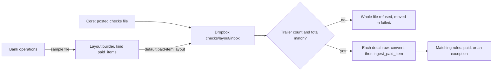

# Paid-item layouts: the core's posted-check file, read as it comes

A bank's core sends the checks it posted each day as a file: fixed-width or delimited, in the
core's own layout, often with a header and a trailer that carries a count and a total. Today
OpenClear can read only its own columns for paid items (`account_number`, `check_number`,
`presented_amount`, `presented_date`), JSON, or an X9.37 image cash letter. So every bank has to
write a converter before positive pay sees a single check. Issued-check files already have a
layout builder (UX_PLAN.md U1). This plan extends it to paid items, so a bank's operations
team maps its core's file once, in the browser, and the dropbox reads it from then on
(FULL_REVIEW_PLAN.md M1, FR-D20).

## What exists today

| Need | Today | Where |
|---|---|---|
| A layout | `import_layout`: tenant, optional customer, `kind` (always `issued_items`), name, settings JSON, one default per owner and kind | `domain/import_layout.py`; `services/import_layout_service.py` (`KIND = "issued_items"`) |
| Reading a file by a layout | Delimited, fixed-width and Excel; columns by header name or position; positions by start and length; skip rows at the top and bottom; `line_prefix` for detail records; implied or decimal amounts; named date formats; leading zeros stripped | `bulk_import/layouts.py` (`FIELDS`, `REQUIRED`, `clean_settings`, `extract`, `convert`, `preview`, `guess`) |
| The builder | Works from a sample file (never stored), assigns a field to each column or a span of text, previews the parsed rows with each error on its field. `issued_item:write`. | `web/routers/layouts.py`; `templates/layouts/`; `static/js/layout-builder.js` |
| Uploading with a layout | `format=layout` with `layout_id`; the upload keeps a copy of the settings, so editing a layout never changes an old upload | `services/bulk_import_service.py` (`_load_layout`, `BUILTIN_SPECS[(ISSUED_ITEMS, "layout")]`); `api/v1/bulk_uploads.py` |
| Paid items from a file | OpenClear's columns (`tabular`), JSON, or X9.37 and ZIP with images. One transaction per row; each runs the matching rules. | `networks/check/bulk_import.py::ingest_paid_item_tabular_rows`; `bulk_import/x937.py` |
| The dropbox | `checks/tabular/inbox/` takes OpenClear's columns only. `issued_items/inbox/` uses the default issued-item layout when one is set. | `services/dropbox_import_service.py` (`_FORMAT_BY_SUBPATH`) |
| A paid item | account, check number, presented amount, presented date, source (`api`, `bulk_file`, `manual`). No payee: that comes from OCR of an image. | `domain/paid_item.py` |

## The flow

## Decisions

- **PIL-D1. One table, a second kind.** `import_layout.kind` already exists, so paid-item
  layouts are rows with `kind = "paid_items"`. `import_layout_service` takes the kind as an
  argument instead of the `KIND` constant; listing, the default and saving are per kind. No
  new table. The migration only adds a check constraint on `kind` (`issued_items`,
  `paid_items`) with `batch_alter_table`.
- **PIL-D2. Paid-item layouts belong to the bank.** The posted-check file comes from the bank's
  core, for every customer at once, so a paid-item layout has no customer (`customer_id` null).
  Building one needs `paid_item:write` and a bank-level session. A customer's people never see
  them.
- **PIL-D3. The fields.** Per kind, `layouts.py` gets its own field list and required set:
  - **Required:** account number, check number (serial), amount, posted date.
  - **Optional:** the MICR on-us field, split into account and serial when the core gives only
    that (a separator character, or positions within it); the routing number, checked against
    the bank's own routing numbers when given; a debit/credit indicator or transaction code,
    with the values that mean "a check debit" (other lines are skipped, not failed); a
    sequence or item number, kept on the row result for tracing.
  - Amount and date formats, leading zeros, `skip_rows`, `skip_footer` and `line_prefix` work
    as they do for issued items. A sign or a trailing minus marks a reversal: skipped and
    counted, never presented.
- **PIL-D4. Trailer totals are checked before any row is imported.** A layout can name a
  trailer line (by prefix, or the last line) and where its item count and total amount are.
  When it does, the whole file is read first; if the detail rows don't add up, the file is
  refused with both figures and nothing is presented. A posted-check file that arrives
  truncated must not present half a day's checks. Without a trailer, rows import one by one as
  today.
- **PIL-D5. Choosing the layout.**
  - **Upload page:** paid items get the same "Layout" choice issued items have; the bank's
    default is selected.
  - **Dropbox:** `checks/tabular/inbox/` uses the bank's default paid-item layout when there is
    one, as `issued_items/inbox/` does. A bank with two cores (after a merger) uses the
    optional per-layout dropbox folder: `checks/layout/<layout slug>/inbox/`. The folder is
    structural, like the rest of the dropbox, never guessed from the content.
  - **API:** `kind=paid_items`, `format=layout`, `layout_id`, as for issued items.
    `GET /api/v1/bulk-uploads/layouts?kind=paid_items` lists them.
- **PIL-D6. The builder is the same builder.** A kind switch at the top (Issued checks / Posted
  checks) changes the field list, the templates and the permission. Templates for paid items:
  "Fixed-width with header and trailer", "CSV with column names", "MICR on-us line". They're
  starting points, not any vendor's specification. The preview also shows the trailer check's
  result for the sample. The settings tile is renamed *File layouts*.
- **PIL-D7. Duplicates are the matching rules' job.** A file imported twice is caught by the
  existing content hash; a check that appears twice is caught as `duplicate_paid` under the
  issued-item lock (FULL_REVIEW_PLAN.md FR2). The layout adds no duplicate logic of its own.
- **PIL-D8. Audit and events.** Saving or deleting a layout is audited (`import_layout.save`,
  `import_layout.delete`, as today) with its kind. A file refused on its trailer is audited
  (`bulk_upload.refused`) and raises a `high` security event: a short posted-check file means
  checks the bank paid may never be reviewed.

## Stages

| Stage | What | Migration | Tests |
|---|---|---|---|
| **PIL1. Layouts by kind** | `import_layout_service` takes a kind; the paid-item field list, required set and `convert` in `layouts.py`; MICR on-us splitting, debit indicator and reversals; the builder's kind switch and templates; `paid_item:write` for paid-item layouts; the API listing by kind; SDKs and OpenAPI regenerated | Check constraint on `import_layout.kind` | `tests/test_bulk_import/` table-driven tests over each template and the MICR forms; the builder preview; a customer can't see or use a paid-item layout |
| **PIL2. Importing with one** | `BUILTIN_SPECS[(PAID_ITEMS, "layout")]`; the trailer check before import; the dropbox default and per-layout folders; the refused-file audit and event; the upload page's layout choice | None | A good file presents every check; a short file is refused whole; a reversal is skipped; the dropbox picks the default, then the folder's layout; the same check in two files is `duplicate_paid` (Postgres, `-m concurrency`) |
| **PIL3. Docs** | The data dictionary (`import_layout.kind`), the upload and dropbox guides, the CHANGELOG, a CUEC "check the posted-check file's totals against the core" for banks without a trailer | None | The docs tests |

## Questions to settle with the first bank

- A sample of its core's posted-check file, with the trailer, to check the templates against.
- Whether the file carries returns and reversals, and how they're marked.
- Whether it sends one file a day or several, and at what times, to set the dropbox schedule.

## Progress log

- 2026-10-21: Plan written (FULL_REVIEW_PLAN.md M1, FR-D20). Not started.
- 2026-10-22: PIL1 built (migration `f847d741d618`, the `kind` check constraint). `layouts.py` reads
  posted checks: `PAID_FIELDS`, the three templates, MICR on-us by separator or positions,
  transaction codes, reversals (`RowSkipped`), and `check_trailer` (built here rather than in PIL2,
  so the builder's preview shows it). The service, builder and API listing take a kind; the tile
  is *File layouts*. **Change from PIL-D3:** a bank has no routing numbers on record, so a
  posted-check layout lists the bank's own (`routing_numbers`), and a line for another fails.
- 2026-10-22: PIL2 built. `BUILTIN_SPECS[(PAID_ITEMS, "layout")]`: the trailer is checked when the
  file arrives, and a mismatch rejects it whole (`TrailerMismatch`), audited as
  `bulk_upload.refused` with a `high` security event. Skipped lines are counted on the upload
  (`skipped_rows`) and shown on its page. The paid-items upload page and the API take a
  posted-check layout; the bank's `checks/tabular/inbox/` reads with its default, and each layout
  has `checks/layout/<name, lowercase with dashes>/inbox/` (two layouts whose names give one
  folder: neither is read, and it's logged). **Changes:** the fixed-width template keeps the
  account as written (space-padded): dropping leading zeros broke accounts that have them. The
  "same check in two files" test runs in order rather than at once: FR2's concurrency test already
  covers two presentments at the same moment.

