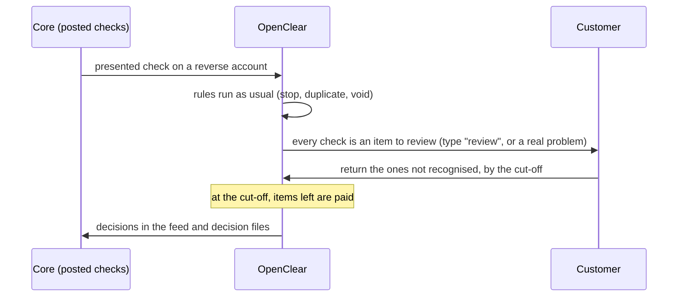

# Reverse positive pay: the customer reviews every check, and silence pays

Some business customers don't send an issued-check file. Small ones write too few checks to bother;
others can't export one from their accounting system. Banks sell them **reverse positive pay**:
the bank shows the customer every check presented against the account each day, the customer
returns the ones they don't recognise by the cut-off, and the rest are paid. OpenClear today
only knows positive pay: a check is compared with the issued file, and only a mismatch reaches the
customer. A customer with no issued file sees every check as `not_in_file`, the default at
the cut-off is "leave open", and the bank has to work around it with a "pay" default the customer
never asked for. This plan adds reverse positive pay as a mode on the account
(FULL_REVIEW_PLAN.md M2, FR-D20).

## What exists today

| Need | Today | Where |
|---|---|---|
| Deciding a presented check | The matching rules compare it with the issued file and stops: `not_in_file`, `amount_mismatch`, `payee_mismatch`, `voided`, `stopped`, `stop_amount_mismatch`, `stale_dated`, `duplicate_paid`. A clean match is paid with no exception. | `networks/check/rules.py`; `networks/check/adapter.py::evaluate`; `networks/check/types.py` |
| Making an exception | On a mismatch: an `exception_item` with the types, the deadline from the cut-off, a score, a notification and the `exception.created` webhook | `networks/check/ingestion.py::ingest_paid_item` |
| The default at the cut-off | Per customer and network: `none` (leave open), `fixed_pay`, `fixed_return` (ACH needs a return reason). A default that pays is a protected change (FR4). | `domain/customer_disposition_setting.py`; `services/auto_disposition_service.py`; `services/change_kinds.py` (`customer.disposition`, `_PAYING_MODES`) |
| The cut-off | Bank-wide per network, a customer's own where agreed, business days and closures | `services/cutoff_service.py` |
| An account's own mode | ACH only: `block_all` or `filter_by_authorization` | `domain/account.py` (`AchDebitBlockMode`) |
| Deciding many at once | Select several on Exceptions and Pay or Return them, each in its own transaction | `web/routers/exceptions.py` (`POST /ui/exceptions/bulk`) |

## The flow

## Decisions

- **RPP-D1. A mode on the account: `check_review_mode`, `positive` (default) or `reverse`.**
  An account, not a customer, because a customer often keeps its payroll account on positive
  pay and a small operating account on reverse. It's set on the account page and in the
  accounts API and bulk file (`check_review_mode` column, optional). The migration adds the
  column with `batch_alter_table`, `native_enum=False`, default `positive`.
- **RPP-D2. Every check on a reverse account is an item, with a new type `review`.**
  - The rules still run. Without an issued file, `not_in_file` is meaningless, so on a reverse
    account it's replaced by `review`; the other types (`stopped`, `duplicate_paid`, `voided`,
    `stale_dated` and the rest) still apply and still show. A check with only `review` is "no
    known problem"; one with others is a problem first.
  - `review` is a `CheckExceptionType`, so lists, filters, the feed, webhooks and the API carry
    it with no new paths. The exceptions page shows it as *To review* and sorts real problems
    first.
  - An account in reverse mode that also has issued items (a customer half-way through moving)
    is matched as usual, and a clean match is still an item to review: reverse means the
    customer sees everything.
- **RPP-D3. On a reverse account, the default at the cut-off is pay.** That's the product's
  promise, so it isn't a per-customer choice:
  - an item whose only type is `review` is paid at the cut-off (`DecisionSource.AUTO_DEFAULT`,
    reason "Not returned by the cut-off");
  - an item with any real problem (`stopped`, `duplicate_paid`, …) follows the customer's own
    default decision as today, so a stopped check is never paid by silence.
- **RPP-D4. Turning reverse mode on is a protected change.** It pays checks nobody reviewed, as
  `fixed_pay` does, so `account.check_review_mode` is a change kind in the `sensitive` group that
  loosens when it goes to `reverse` (FR4's rule for paying defaults). Turning it off takes
  effect at once. It's audited (`account.check_review_mode`) and raises `settings.changed`.
- **RPP-D5. Checks only, first.** ACH already has its own review-everything answer: an account
  with `filter_by_authorization` and no authorizations raises every debit. The ACH page says so
  ("To review every debit, add no authorizations"). An ACH reverse mode waits for a bank to
  ask.
- **RPP-D6. Volume: the customer reviews a day's checks in one pass.**
  - *Approve all shown* on Exceptions, for `review`-only items on the current filter, as one
    action with a count to confirm ("Pay 48 checks"). Each is still its own decision and
    transaction under the item lock (FR1), with dual control as the bank set it.
  - One notification a day per customer ("12 checks to review by 11:00"), not one per check:
    reverse accounts are excluded from the per-exception email and included in the reminder
    before the cut-off (`reminder_service`).
  - The dashboard counts *to review* separately from *problems*.
- **RPP-D7. Reports and the score.** The decision history and CSV export show which items were
  paid by silence (`source = auto_default`, type `review`). The advisory fraud score (SP2), when
  the bank has it on, ranks review items, which is where it helps most; it still decides
  nothing.
- **RPP-D8. Billing is frozen** (FR-D19 item 11). No new metric. If billing resumes, reverse
  accounts are counted by the existing per-account metrics.
- **RPP-D9. Controls.** A new bank CUEC: "Agree reverse positive pay in writing with the
  customer, including that unreturned checks are paid". A check `reverse_accounts_agreed` lists
  reverse accounts turned on in the period, for the bank to match against its agreements.

## Stages

| Stage | What | Migration | Tests |
|---|---|---|---|
| **RPP1. The mode and the type** | `account.check_review_mode`; the account page, API and bulk column; `CheckExceptionType.REVIEW` and its place in `rules.py` (the account's mode in `CheckMatchInputs`); the protected change kind; data dictionary; OpenAPI and SDKs | `account.check_review_mode` | `tests/test_networks/` table-driven: a reverse account's clean check, stopped check, duplicate, issued and matched; positive accounts unchanged |
| **RPP2. The cut-off and the queue** | Pay at the cut-off for `review`-only items in `auto_disposition_service`; *Approve all shown*; the daily notification and reminder; *To review* on the dashboard and Exceptions; the CUEC and check | None | A review item is paid at the cut-off and a stopped one isn't; approve-all under dual control; one email a day; the lock at the cut-off racing an approval (Postgres, `-m concurrency`) |
| **RPP3. Docs** | The customer guide ("Reviewing your checks"), the bank's setup guide, the CHANGELOG | None | Docs tests; screenshots and viewport references regenerated |

## Questions to settle with the first bank

- Whether its reverse customers expect images on the review page (needing X9.37 or image files
  for those accounts), or the amount and check number are enough.
- The cut-off it offers reverse customers, which is often earlier than for positive pay.
- Whether a check returned by a reverse customer needs a reason code from them, or the bank
  supplies one.

## Progress log

- 2026-10-21: Plan written (FULL_REVIEW_PLAN.md M2, FR-D20). Not started.
- 2026-10-22: RPP1 built (migration `7f7bc3cb2b34`): `account.check_review_mode`, `CheckExceptionType.REVIEW`
  (labelled *To review*), `CheckMatchInputs.review_all` from the account's mode, the protected change
  `account.check_review_mode` (`admin:manage`, loosens on `reverse`, `settings.changed`), the account's
  *Check review* page linked from the customer's accounts, and `check_review_mode` in the accounts
  API (`202` while reverse waits for a second admin). **Changes from RPP-D1:** setting it is for the
  bank's administrators only (`admin:manage`, never a customer's people), and the accounts bulk file
  has no column for it: a protected change can't arrive in a file without its approval.

