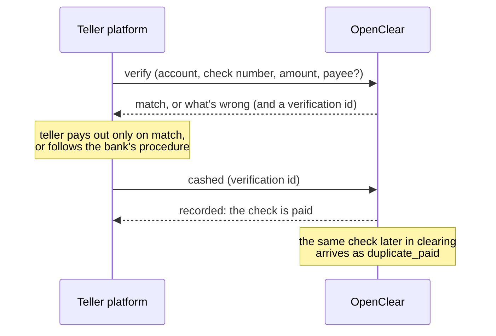

# Teller positive pay

When someone cashes a business customer's check at a branch, the teller platform should ask
OpenClear before paying out: was this check issued, for this amount, to this payee, and is it
still good? Today positive pay only sees checks in clearing, hours or a day later, by which time
the cash is gone. This plan adds a verification call the teller platform makes while the
transaction is open, and a second call when the cash is paid, so the same check can't be paid
again elsewhere.

## What exists today

| Need | Today | Where |
|---|---|---|
| Is this check good? | The clearing rules decide it for presented items: `not_in_file`, `amount_mismatch`, `payee_mismatch`, `voided`, `stopped`, `stale_dated`, `duplicate_paid`. A pure function, with no database session. | `networks/check/rules.py`, `networks/check/types.py` |
| Looking a check up | `GET /api/v1/issued-items` filters by account and status only, not check number. A teller platform would have to list every outstanding check on the account. | `api/v1/issued_items.py` |
| A check already paid | `duplicate_paid` when a paid item with the same account, check number and amount was already paid | `networks/check/adapter.py::_is_duplicate_paid` |
| Where a presentment came from | `PaidItemSource`: api, bulk_file, manual, training_backfill | `domain/paid_item.py` |
| Bank systems calling OpenClear | Bank-level API clients with a security group; `private_key_jwt`; rate limits per client | `auth/`, `web/rate_limit.py` |

## The flow

## Decisions

- **TL-D1. One purpose-built call: `POST /api/v1/checks/verify`.**
  - **Request:** the routing and account number and check number from the MICR line, the
    amount, and optionally the payee name the teller read.
  - **Response:** `result` (`match`, or the first problem: `not_issued`, `voided`, `stopped`,
    `already_paid`, `stale`, `amount_differs`, `payee_differs`), every problem found, and a
    `verification_id`.
  - **Issued details:** returned only when the result isn't `match` and the check was issued:
    amount, payee and issue date. A teller needs them to explain a mismatch, and nothing more.
  - **Same rules as clearing:** it runs the clearing rules (`rules.py`), so a teller and the
    clearing process can't disagree about a check.
- **TL-D2. A narrow permission, `check:verify`,** in its own security group (a "Teller
  platform" template). It covers verifying and recording a cash-out, and nothing else. It
  can't list issued items, so a teller system can't be used to download a customer's check
  register.
- **TL-D3. "Cashed" marks the check paid at once: `POST /api/v1/checks/cashed`.** It takes the
  `verification_id` and the amount paid out, and creates a paid item with a new source,
  `teller`. A later presentment of the same check (a mobile deposit, another bank, the same
  check cashed twice) arrives as `duplicate_paid`. Waiting for the core to post it would leave
  a window to pay the same check twice. A verification expires after 15 minutes, and a
  `verification_id` can be cashed only once.
- **TL-D4. A mismatch means decline, in the first version.** The business customer can't decide
  while someone waits at the counter. The teller follows the bank's procedure (usually: decline,
  or phone the customer). Each refused verification still shows on the customer's exceptions
  page as information ("presented at a branch and declined"), so the customer knows someone
  tried. A **teller exception** the customer can approve within minutes is a later phase
  (TL-4), and only if banks ask for it.
- **TL-D5. Fast, and a known answer when slow.**
  - **Target:** 300 ms at the 95th percentile. The call reads one issued item and its stop
    payments, and does no ML scoring or OCR.
  - **When OpenClear can't answer** (timeout or 5xx), the teller platform applies the bank's
    fallback policy, for example decline above an amount. That's a new CUEC: OpenClear can't
    enforce it.
- **TL-D6. Every call is recorded and limited.**
  - **Recorded:** each verification and each cash-out goes in the action log, with the teller's
    id and branch from the platform (`teller_id`, `branch` in the request; the platform
    authenticates, so OpenClear trusts it for these). Each also raises a security event
    (`teller.verify`, `teller.cashed`). A refusal is `teller.verify.declined`.
  - **Limited:** a per-client rate limit, and a security event when one branch or teller id
    verifies an unusual number of checks that fail with `not_issued`. Probing for check numbers
    looks like that.
- **TL-D7. Platform-agnostic, with one reference integration.** The API is plain REST and JSON
  with the SDKs. The first teller platform a bank brings (Jack Henry, Fiserv, FIS or another) gets
  a worked example and a test harness, like the Fineract adapter. Until then the guide shows the
  calls.

## Phases

| Phase | What lands | Migration | Outside checks |
|---|---|---|---|
| **TL-1. Verify** | `POST /api/v1/checks/verify` using `rules.py`; `check:verify` permission and a "Teller platform" group template; the action log entries, events and rate limit; the guide `docs/guides/teller.md`; SDKs regenerated. | `teller_verification` (id, tenant, account, check number, amount, result, problems, teller, branch, expires, cashed) with RLS | — |
| **TL-2. Cashed** | `POST /api/v1/checks/cashed`; `PaidItemSource.TELLER`; the verification marked cashed; declined verifications shown as information on the customer's exceptions page; the probing alert. | Paid item source value (string column, no schema change); `teller_verification.cashed_at` if not in TL-1 | — |
| **TL-3. Reference integration** | A worked example and harness for the first bank's teller platform; the fallback-policy CUEC; the response-time target in the controls (OC-SI). | None | The bank's teller test environment |
| **TL-4. Teller exceptions (only if asked for)** | A mismatch can wait for the customer: an exception with a deadline of minutes, pushed by SMS and email, decided from a phone. The teller platform polls the verification until it's decided or expires. | Exception deadline in minutes | A bank pilot |

## Testing

- **Table-driven tests over every result:** issued and outstanding, a different amount, a
  different payee (fuzzy, as clearing does), voided, stopped, paid in clearing, cashed at a
  teller, stale, not issued, and an account that isn't on positive pay. Each is checked
  against what clearing would decide for the same check.
- **Cashed:** cashing once marks the check paid; a second cash of the same `verification_id` is
  refused; an expired verification is refused; the same check later in clearing comes out as
  `duplicate_paid`.
- **Permissions and limits:** a `check:verify` client can't read `/issued-items`; a customer's
  client can't verify at all; another bank's checks are invisible under row-level security
  (`tests/test_postgres/`); the rate limit and the probing alert.
- **Speed:** the call's database round trips are counted in a test (one read for the issued
  item, one for stops), so a later change can't quietly make it slow.

## Questions to settle with the first bank

- How its teller platform identifies the teller and branch, and whether it can send the payee it
  read.
- Its fallback when OpenClear doesn't answer, and the amount threshold.
- Whether checks drawn on accounts not on positive pay should still be verified, with the result
  "not on positive pay", or not sent at all.

## Progress log

- 2026-10-18: Plan written. Not started.
