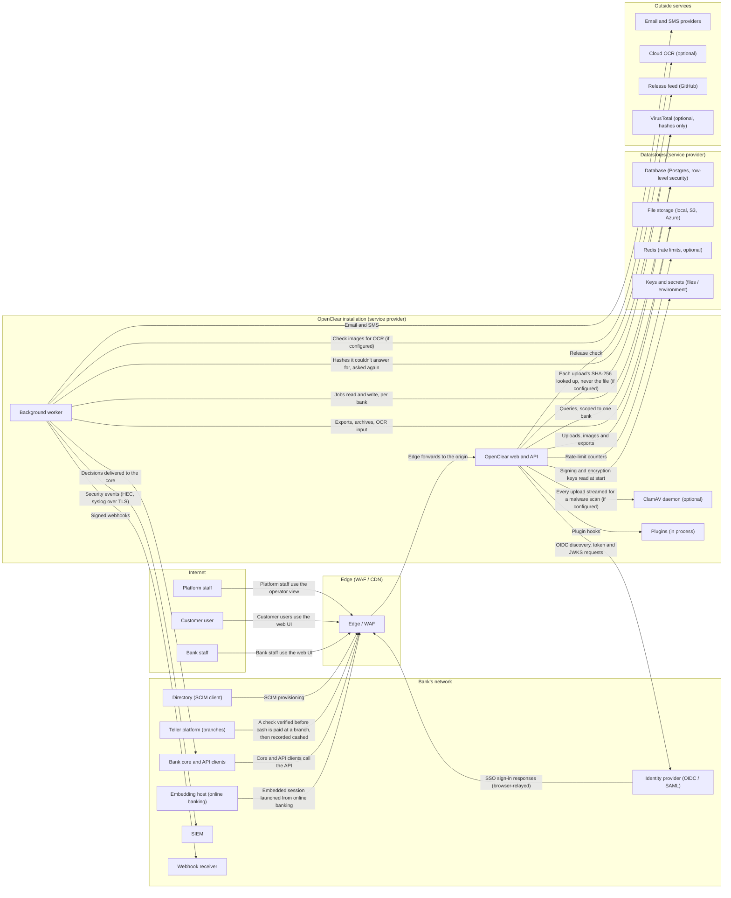

# Threat model

<!-- Generated by scripts/render_threat_model.py from threat_model/openclear.py. Edit those, not this page. -->

How OpenClear could be attacked, and what stops it. It's kept as code with
[OWASP pytm](https://github.com/OWASP/pytm) (`threat_model/openclear.py`) so it changes in the
same pull request as the system it describes, and a test fails when this page falls behind.
Terms are as in [CONTEXT.md](../../CONTEXT.md). It isn't legal advice, and it doesn't replace
each bank's own assessment of how it runs OpenClear.

## Data flows

| Flow | From → to | Protocol | Data |
|---|---|---|---|
| Bank staff use the web UI | Bank staff → Edge / WAF | HTTPS | Accounts, issued items and ACH data, Exceptions and pay / return decisions, Passwords and security-key assertions, Session tokens |
| Customer users use the web UI | Customer user → Edge / WAF | HTTPS | Accounts, issued items and ACH data, Exceptions and pay / return decisions, Passwords and security-key assertions, Session tokens |
| Platform staff use the operator view | Platform staff → Edge / WAF | HTTPS | Passwords and security-key assertions, Session tokens |
| Embedded session launched from online banking | Embedding host (online banking) → Edge / WAF | HTTPS | SSO assertions and ID tokens, Session tokens |
| Core and API clients call the API | Bank core and API clients → Edge / WAF | HTTPS | API client secrets and signed assertions, Accounts, issued items and ACH data, Exceptions and pay / return decisions, Payment files (X9.37, NACHA, CSV, Excel, zip) |
| A check verified before cash is paid at a branch, then recorded cashed | Teller platform (branches) → Edge / WAF | HTTPS | API client secrets and signed assertions, Accounts, issued items and ACH data |
| SSO sign-in responses (browser-relayed) | Identity provider (OIDC / SAML) → Edge / WAF | HTTPS | SSO assertions and ID tokens |
| SCIM provisioning | Directory (SCIM client) → Edge / WAF | HTTPS | API client secrets and signed assertions, People and group memberships |
| Edge forwards to the origin | Edge / WAF → OpenClear web and API | HTTPS | Accounts, issued items and ACH data, Exceptions and pay / return decisions, Passwords and security-key assertions, Payment files (X9.37, NACHA, CSV, Excel, zip), Session tokens |
| OIDC discovery, token and JWKS requests | OpenClear web and API → Identity provider (OIDC / SAML) | HTTPS | SSO assertions and ID tokens |
| Queries, scoped to one bank | OpenClear web and API → Database (Postgres, row-level security) | SQL | Accounts, issued items and ACH data, Action log, Exceptions and pay / return decisions, People and group memberships |
| Uploads, images and exports | OpenClear web and API → File storage (local, S3, Azure) | HTTPS | Check images, Payment files (X9.37, NACHA, CSV, Excel, zip) |
| Rate-limit counters | OpenClear web and API → Redis (rate limits, optional) | RESP | — |
| Signing and encryption keys read at start | OpenClear web and API → Keys and secrets (files / environment) | file | — |
| Plugin hooks | OpenClear web and API → Plugins (in process) | in-process | Accounts, issued items and ACH data, Exceptions and pay / return decisions |
| Jobs read and write, per bank | Background worker → Database (Postgres, row-level security) | SQL | Accounts, issued items and ACH data, Action log, Exceptions and pay / return decisions |
| Exports, archives, OCR input | Background worker → File storage (local, S3, Azure) | HTTPS | Action log, Check images, Payment files (X9.37, NACHA, CSV, Excel, zip) |
| Security events (HEC, syslog over TLS) | Background worker → SIEM | HTTPS | Security events |
| Signed webhooks | Background worker → Webhook receiver | HTTPS | Exceptions and pay / return decisions |
| Decisions delivered to the core | Background worker → Bank core and API clients | HTTPS | Exceptions and pay / return decisions |
| Email and SMS | Background worker → Email and SMS providers | HTTPS | Notifications |
| Check images for OCR (if configured) | Background worker → Cloud OCR (optional) | HTTPS | Check images |
| Release check | OpenClear web and API → Release feed (GitHub) | HTTPS | — |
| Every upload streamed for a malware scan (if configured) | OpenClear web and API → ClamAV daemon (optional) | clamd | Check images, Payment files (X9.37, NACHA, CSV, Excel, zip) |
| Each upload's SHA-256 looked up, never the file (if configured) | OpenClear web and API → VirusTotal (optional, hashes only) | HTTPS | — |
| Hashes it couldn't answer for, asked again | Background worker → VirusTotal (optional, hashes only) | HTTPS | — |

## Threats specific to OpenClear

Positive pay's own threats, by [STRIDE](https://owasp.org/www-community/Threat_Modeling_Process)
category (Spoofing, Tampering, Repudiation, Information disclosure, Denial of service, Elevation
of privilege). Evidence names [OpenClear's controls](../compliance/controls.md), code and
ASVS 5.0 requirements. "CUEC" means the protection depends on the service provider or the bank
([CUECs](../compliance/cuecs.md)).

| Id | STRIDE | Boundary | Threat | Mitigation | Evidence | Status |
|---|---|---|---|---|---|---|
| OC-T01 | E | Bank ↔ bank | One bank's people or data reach another bank. | Every query runs in one bank's context; Postgres row-level security enforces it under a non-superuser role. | OC-AC-09; db/tenancy.py; tests/test_postgres/test_rls_*.py; ASVS 8.4.1 | Mitigated |
| OC-T02 | E | Customer ↔ customer | A customer's people see another customer's accounts, items or images. | Customer- and account-scoped repositories on every query; per-account access. | OC-AC-03, OC-AC-04; repositories/; db/account_scope.py; ASVS 8.2.2 | Mitigated |
| OC-T03 | S | Bank ↔ bank | A session from one organization's sign-in is used to enter another organization the same person belongs to, without that organization's sign-on rules. | Sessions record how they were signed in; switching is allowed only where that sign-in is accepted. | web/routers/tenant_switch.py::switch_refusal; 1.21.2; ASVS 6.3.4, 6.8.1 | Mitigated |
| OC-T04 | S | Identity provider | A bank's or customer's identity provider asserts someone it doesn't vouch for. | A provider links only people already members in its own scope, matched by its stable subject; groups are re-read on every sign-in; a customer's sign-on is confined to that customer. | OC-IA-03, OC-IA-05; services/sso_service.py; SECURITY_REVIEW.md R2; ASVS 6.8.1, 10.5.2 | Mitigated |
| OC-T05 | S | Internet | Password guessing and credential stuffing. | Lockout, per-person and per-IP rate limits, the bank's password policy (15 characters for new banks), breached and context-word checks, passwords re-checked at sign-in, the same answer for unknown and locked accounts, and security keys a bank or customer can require. | OC-IA-01, OC-IA-02, OC-SC-06; auth/breached_passwords.py; auth/security_key_policy.py; ASVS 6.2.4, 6.2.12, 6.3.3, 6.3.8 | Mitigated |
| OC-T06 | S | Internet | A stolen session cookie is replayed. | HttpOnly, Secure, SameSite cookies; idle and absolute timeouts; server-side revocation; token version bump on password change. | OC-AC-10, OC-SC-04; services/session_service.py; ASVS 7.x | Mitigated |
| OC-T07 | T | Customer ↔ bank | One person issues and approves the same payment decision, or weakens a protection alone. | Segregation of duties; dual control on decisions; two people for settings changes, at bank, customer and service provider. | OC-AC-05, OC-AC-06, OC-AC-07, OC-AC-13; DUAL_CONTROL_PLAN.md | Mitigated |
| OC-T08 | T | Bank's network | A forged or altered payment file (X9.37, NACHA, CSV) creates false issued items or presentments. | Uploads only by permitted people or API clients; hardened parsers; every file kept with its SHA-256 and a signature; row-by-row results. | OC-SI-01, OC-SI-02, OC-SC-03 | Mitigated |
| OC-T09 | T | Data stores | The action log is altered to hide a decision or a settings change. | Chained, signed entries; verified daily; archived to signed files; the provider's own log likewise. | OC-AU-01, OC-AU-02, OC-AU-03 | Mitigated |
| OC-T10 | R | Customer ↔ bank | Someone denies having decided an exception or changed a setting. | Every change in the action log with who, when, from where and the request id; signed evidence export. | OC-AU-01, OC-AU-05 | Mitigated |
| OC-T11 | I | Internet | Account numbers or check images leak through the browser, caches or URLs. | no-store on the UI and API; CSP; no third-party scripts; access limited by customer and account. | OC-SC-04; web/security_headers.py; ASVS 14.2, 14.3 | Partly (issues #13, #14) |
| OC-T12 | I | Outside services | Data sent to an outside service (cloud OCR, email, SMS, SIEM, webhooks) is exposed or sent somewhere unintended. | Each service is off unless configured, reviewed per bank; outbound connections only to public addresses; webhooks signed; no secrets in events. | OC-SC-07, OC-AU-04; services/outside_services.py | Mitigated |
| OC-T13 | I | Outside services | A webhook, SIEM or SSO URL is pointed at an internal address (SSRF). | The address is checked on the connection itself, so DNS rebinding doesn't get past it. | OC-SC-07; auth/outbound_http.py; ASVS 1.3.6 | Mitigated |
| OC-T14 | E | Service provider | Platform staff read or change a bank's data. | Support access only through a time-limited grant the bank makes; platform sign-in always needs a security key; two people at the service provider for provider actions; the provider's own signed log. | OC-AC-08, OC-AC-13; ADR 0004 | Mitigated |
| OC-T15 | E | Installation | A plugin misbehaves or is malicious. | Plugins are installed and enabled by the service provider and each bank; they run in process, so they are trusted code; what's enabled is in the evidence export. | OC-CM-03; docs/PLUGINS.md | Service provider's (CUEC) |
| OC-T16 | T | Data stores | A swapped ML model file runs code or skews decisions. | Model files are checked against a signed digest before loading; activation needs two people. | ml/registry.py; OC-AC-13; SR 11-7 page | Mitigated |
| OC-T17 | D | Internet | Large or malicious uploads (zip bombs, huge images) exhaust the server. | Request size, declared and actual zip size, and image pixel limits; long work runs as jobs with time limits. | OC-SI-01; bulk_import/zip_import.py, bulk_import/images.py; ASVS 5.2 | Mitigated |
| OC-T18 | D | Bank's network | Decisions miss the return deadline because OpenClear or the core is down. | Deadlines shown with reminders; an outbox delivers decisions with retries; health and job status reported. | OC-SI-05, OC-SI-06, OC-CA-02 | Mitigated |
| OC-T19 | S | Edge | Requests bypass the WAF by reaching the origin directly, or forge the caller's address. | The caller's address is taken only from the configured edge; an edge secret; the edge guide. | OC-SC-05; docs/guides/edge.md; scripts/edge_check.py | Partly (service provider locks the origin) |
| OC-T20 | I | Data stores | Keys or secrets leak from the server. | Production refuses checked-in keys; secrets in the database are encrypted with a rotatable key; keys rotated on the bank's schedule. | OC-CM-01, OC-SC-01; auth/crypto.py; issue #10 | Service provider's (CUEC) |
| OC-T21 | T | Bank's network | An ACH debit from an unauthorized originator is paid. | Debits checked against the customer's authorized originators; unauthorized debits go to exception with a Written Statement of Unauthorized Debit, which the bank collects on its own form. | OC-AC-12, OC-SI-07; docs/compliance/nacha.md | Mitigated |
| OC-T22 | I | Embedding host | OpenClear is framed by a site that isn't the bank's online banking (clickjacking) or leaks messages to it. | frame-ancestors limited to the bank's configured origin; messages posted only to that origin. | web/security_headers.py; static/js/app.js; ASVS 3.4.6 | Mitigated |
| OC-T23 | I | Bank's network | A teller platform's credentials are used to probe for valid check numbers, or the same check is cashed at two branches. | check:verify can only verify and record a cash-out, never list issued items; what was issued is returned only to explain a decline; every call is logged, rate-limited, and many not-issued answers raise a high security event; a verification is cashed once, within 15 minutes, under the issued check's lock, and the paid check is a duplicate anywhere after. | OC-SI-09; services/teller_service.py; TELLER_PLAN.md | Mitigated |

## Generic threats (pytm's library)

pytm matches every element and flow against its threat library (based on CAPEC). These are
the threats it raises for this model, most severe first. Most are answered by the controls
above and by the [ASVS assessment](../../plans/OWASP_PLAN.md); they're listed so that a change to
the model that raises a new one shows up in review.

259 findings across 76 threats.

| pytm id | Threat | Severity | Elements |
|---|---|---|---|
| AC06 | Using Malicious Files | Very High | Edge / WAF |
| AC14 | Catching exception throw/signal from privileged block | Very High | Plugins (in process) |
| AC17 | Session Hijacking - ServerSide | Very High | Edge / WAF |
| AC18 | Session Hijacking - ClientSide | Very High | Background worker, Plugins (in process) |
| AC21 | Cross Site Request Forgery | Very High | Background worker, Plugins (in process) |
| DS06 | Data Leak | Very High | A check verified before cash is paid at a branch, then recorded cashed, Bank staff use the web UI, Check images for OCR (if configured), Core and API clients call the API, Customer users use the web UI, Decisions delivered to the core, Edge forwards to the origin, Email and SMS, Embedded session launched from online banking, Every upload streamed for a malware scan (if configured), Exports, archives, OCR input, Jobs read and write, per bank, OIDC discovery, token and JWKS requests, Platform staff use the operator view, Plugin hooks, Queries, scoped to one bank, SCIM provisioning, SSO sign-in responses (browser-relayed), Security events (HEC, syslog over TLS), Signed webhooks, Uploads, images and exports |
| HA01 | Path Traversal | Very High | Edge / WAF |
| INP02 | Overflow Buffers | Very High | Background worker, Plugins (in process) |
| INP05 | Command Line Execution through SQL Injection | Very High | Edge / WAF |
| INP07 | Buffer Manipulation | Very High | Background worker, Plugins (in process) |
| INP23 | File Content Injection | Very High | Background worker, Plugins (in process) |
| SC02 | XSS Targeting Non-Script Elements | Very High | Edge / WAF |
| AA03 | Exploitation of Trusted Credentials | High | Edge / WAF |
| AA04 | Exploiting Trust in Client | High | Edge / WAF |
| AC12 | Privilege Escalation | High | Background worker, Plugins (in process) |
| AC15 | Schema Poisoning | High | Plugins (in process) |
| AC16 | Session Credential Falsification through Prediction | High | Edge / WAF |
| AC20 | Reusing Session IDs (aka Session Replay) - ClientSide | High | Background worker, Plugins (in process) |
| CR01 | Session Sidejacking | High | OpenClear web and API |
| CR03 | Dictionary-based Password Attack | High | Background worker, Edge / WAF, Plugins (in process) |
| CR06 | Communication Channel Manipulation | High | A check verified before cash is paid at a branch, then recorded cashed, Bank staff use the web UI, Check images for OCR (if configured), Core and API clients call the API, Customer users use the web UI, Decisions delivered to the core, Each upload's SHA-256 looked up, never the file (if configured), Edge forwards to the origin, Email and SMS, Embedded session launched from online banking, Every upload streamed for a malware scan (if configured), Exports, archives, OCR input, Hashes it couldn't answer for, asked again, Jobs read and write, per bank, OIDC discovery, token and JWKS requests, Platform staff use the operator view, Plugin hooks, Queries, scoped to one bank, Rate-limit counters, Release check, SCIM provisioning, SSO sign-in responses (browser-relayed), Security events (HEC, syslog over TLS), Signed webhooks, Signing and encryption keys read at start, Uploads, images and exports |
| DE04 | Audit Log Manipulation | High | Database (Postgres, row-level security), File storage (local, S3, Azure), Keys and secrets (files / environment), Redis (rate limits, optional) |
| DR01 | Unprotected Sensitive Data | High | Every upload streamed for a malware scan (if configured), Plugin hooks |
| INP03 | Server Side Include (SSI) Injection | High | Edge / WAF |
| INP08 | Format String Injection | High | Background worker, Edge / WAF, Plugins (in process) |
| INP09 | LDAP Injection | High | Edge / WAF |
| INP11 | Relative Path Traversal | High | Edge / WAF |
| INP12 | Client-side Injection-induced Buffer Overflow | High | Background worker, Plugins (in process) |
| INP13 | Command Delimiters | High | Background worker, Plugins (in process) |
| INP16 | PHP Remote File Inclusion | High | Edge / WAF |
| INP20 | iFrame Overlay | High | Background worker, Plugins (in process) |
| INP22 | XML Attribute Blowup | High | Edge / WAF |
| INP24 | Filter Failure through Buffer Overflow | High | Background worker, Plugins (in process) |
| INP25 | Resource Injection | High | Background worker, Plugins (in process) |
| INP26 | Code Injection | High | Background worker, Plugins (in process) |
| INP28 | XSS Targeting URI Placeholders | High | Background worker, Edge / WAF, Plugins (in process) |
| INP31 | Command Injection | High | Background worker, Plugins (in process) |
| INP32 | XML Injection | High | Background worker, Plugins (in process) |
| INP33 | Remote Code Inclusion | High | Background worker, Plugins (in process) |
| INP34 | SOAP Array Overflow | High | Edge / WAF |
| INP35 | Leverage Alternate Encoding | High | Background worker, Plugins (in process) |
| INP37 | HTTP Request Smuggling | High | Edge / WAF |
| INP41 | Argument Injection | High | Background worker, Plugins (in process) |
| SC03 | Embedding Scripts within Scripts | High | Edge / WAF |
| SC04 | XSS Using Alternate Syntax | High | Edge / WAF |
| SC05 | Removing Important Client Functionality | High | Edge / WAF, OpenClear web and API |
| AA01 | Authentication Abuse/ByPass | Medium | Background worker, Edge / WAF, Plugins (in process) |
| AA02 | Principal Spoof | Medium | Background worker, Edge / WAF, Plugins (in process) |
| AC01 | Privilege Abuse | Medium | Background worker, Database (Postgres, row-level security), Edge / WAF, File storage (local, S3, Azure), Keys and secrets (files / environment), Plugins (in process), Redis (rate limits, optional) |
| AC05 | Content Spoofing | Medium | A check verified before cash is paid at a branch, then recorded cashed, Bank staff use the web UI, Check images for OCR (if configured), Core and API clients call the API, Customer users use the web UI, Decisions delivered to the core, Each upload's SHA-256 looked up, never the file (if configured), Edge forwards to the origin, Email and SMS, Embedded session launched from online banking, Every upload streamed for a malware scan (if configured), Exports, archives, OCR input, Hashes it couldn't answer for, asked again, Jobs read and write, per bank, OIDC discovery, token and JWKS requests, Platform staff use the operator view, Plugin hooks, Queries, scoped to one bank, Rate-limit counters, Release check, SCIM provisioning, SSO sign-in responses (browser-relayed), Security events (HEC, syslog over TLS), Signed webhooks, Signing and encryption keys read at start, Uploads, images and exports |
| AC07 | Exploiting Incorrectly Configured Access Control Security Levels | Medium | Edge / WAF |
| AC08 | Manipulate Registry Information | Medium | Edge / WAF |
| AC09 | Functionality Misuse | Medium | Edge / WAF |
| AC11 | Session Credential Falsification through Manipulation | Medium | Edge / WAF |
| AC13 | Hijacking a privileged process | Medium | Background worker, Plugins (in process) |
| CR08 | Client-Server Protocol Manipulation | Medium | Every upload streamed for a malware scan (if configured), Plugin hooks, Signing and encryption keys read at start |
| DE01 | Interception | Medium | A check verified before cash is paid at a branch, then recorded cashed, Bank staff use the web UI, Check images for OCR (if configured), Core and API clients call the API, Customer users use the web UI, Decisions delivered to the core, Each upload's SHA-256 looked up, never the file (if configured), Edge forwards to the origin, Email and SMS, Embedded session launched from online banking, Every upload streamed for a malware scan (if configured), Exports, archives, OCR input, Hashes it couldn't answer for, asked again, Jobs read and write, per bank, OIDC discovery, token and JWKS requests, Platform staff use the operator view, Plugin hooks, Queries, scoped to one bank, Rate-limit counters, Release check, SCIM provisioning, SSO sign-in responses (browser-relayed), Security events (HEC, syslog over TLS), Signed webhooks, Signing and encryption keys read at start, Uploads, images and exports |
| DE02 | Double Encoding | Medium | Background worker, Edge / WAF, Plugins (in process) |
| DE03 | Sniffing Attacks | Medium | A check verified before cash is paid at a branch, then recorded cashed, Bank staff use the web UI, Check images for OCR (if configured), Core and API clients call the API, Customer users use the web UI, Decisions delivered to the core, Each upload's SHA-256 looked up, never the file (if configured), Edge forwards to the origin, Email and SMS, Embedded session launched from online banking, Every upload streamed for a malware scan (if configured), Exports, archives, OCR input, Hashes it couldn't answer for, asked again, Jobs read and write, per bank, OIDC discovery, token and JWKS requests, Platform staff use the operator view, Plugin hooks, Queries, scoped to one bank, Rate-limit counters, Release check, SCIM provisioning, SSO sign-in responses (browser-relayed), Security events (HEC, syslog over TLS), Signed webhooks, Signing and encryption keys read at start, Uploads, images and exports |
| DO01 | Flooding | Medium | Background worker, Edge / WAF, OpenClear web and API, Plugins (in process) |
| DO02 | Excessive Allocation | Medium | Database (Postgres, row-level security), File storage (local, S3, Azure), Keys and secrets (files / environment), Plugins (in process), Redis (rate limits, optional) |
| DS01 | Excavation | Medium | Edge / WAF |
| DS04 | XSS Targeting Error Pages | Medium | Edge / WAF |
| INP10 | Parameter Injection | Medium | Edge / WAF |
| INP14 | Input Data Manipulation | Medium | Background worker, Edge / WAF, Plugins (in process) |
| INP17 | XSS Using MIME Type Mismatch | Medium | Edge / WAF, OpenClear web and API |
| INP19 | XML External Entities Blowup | Medium | Edge / WAF |
| INP21 | DTD Injection | Medium | Edge / WAF |
| INP27 | XSS Targeting HTML Attributes | Medium | Background worker, Plugins (in process) |
| INP29 | XSS Using Doubled Characters | Medium | Background worker, Edge / WAF, Plugins (in process) |
| INP30 | XSS Using Invalid Characters | Medium | Background worker, Plugins (in process) |
| INP36 | HTTP Response Smuggling | Medium | Edge / WAF |
| CR05 | Encryption Brute Forcing | Low | Database (Postgres, row-level security), Edge / WAF, File storage (local, S3, Azure), Keys and secrets (files / environment), OpenClear web and API, Redis (rate limits, optional) |
| HA03 | Web Application Fingerprinting | Low | Edge / WAF |
| INP18 | Fuzzing and observing application log data/errors for application mapping | Low | Edge / WAF |
| DS03 | Footprinting | Very Low | Edge / WAF |

## Privacy (LINDDUN GO)

A pass over the [LINDDUN GO](https://linddun.org/go/) cards, by category:

| Category | OpenClear | Where |
|---|---|---|
| Linking | Records link to a bank, a customer and a person by design; nothing links people across banks except one person's own memberships, which only that person and each bank's admins see. | `db/tenancy.py::memberships_elsewhere` |
| Identifying | Check images and payee names identify people; access is by customer and account scope, and every view of an item is permission-checked. | OC-AC-03, OC-AC-04 |
| Non-repudiation | Decisions are deliberately attributable (the action log); that's a requirement of the bank's records, disclosed to its staff and customers. | OC-AU-01 |
| Detecting | Security events reveal sign-in patterns; they go only to the bank's own SIEM and carry no passwords, tokens or account numbers. | SIEM_PLAN.md, "What's never in an event" |
| Data disclosure | Outside services (cloud OCR, email, SMS) are off unless the bank turns them on and reviews them. No decisions are pooled across banks: a bank's fraud model, off until the bank turns it on, learns only from its own decisions. | `services/outside_services.py`, OC-AC-09 |
| Unawareness | Customers' people see what's kept about their decisions in the action log their admins can read; the fraud score shown on an item is labelled advisory. | OC-AU-01 |
| Non-compliance | Retention periods are installation settings (finished jobs, notifications, upload results, exports, security events); the action log is kept and archived to signed files. Removing a departing bank's data is the service provider's job: there's no in-app offboarding yet. | `config.py` `retention_*`; OC-AU-03 |
